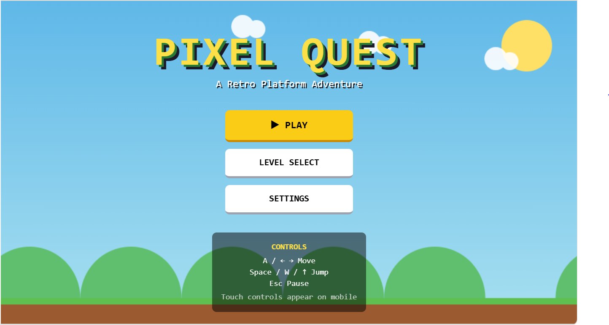

# 🎮 Pixel Quest

**A pixel-inspired browser game built with React and Base44.**

Pixel Quest is a web-based gaming project featuring interactive gameplay, level selection, game settings, audio, and a player interface. This project is built with React and Base44, with support for local development and GitHub synchronization.

<p align="center">
  <a href="https://pixel-quest-play-bald.base44.app">
    
  </a>
  <a href="https://github.com/Ericdama/pixel-quest">
    
  </a>
</p>

## 🔗 Project Links

- 🎮 **Live Demo:** [Play Pixel Quest](https://pixel-quest-play-bald.base44.app)
- 💻 **Source Code:** [GitHub Repository](https://github.com/Ericdama/pixel-quest)

## 📸 Screenshots

### Main Menu



*The main menu of Pixel Quest, featuring a retro-inspired gaming experience.*

More screenshots, including gameplay, level selection, and settings, can be added as the project develops.

## ✨ Features

- 🎮 **Interactive Gameplay** — Browser-based gaming experience.
- 🗺️ **Level Selection** — Interface for selecting game levels.
- 🏆 **Leaderboard** — Interface for displaying player scores.
- ⚙️ **Game Settings** — Customize available game options.
- 📱 **Mobile Controls** — Dedicated mobile control interface.
- 🔐 **Authentication** — Login, registration, and password recovery interfaces.
- 🔊 **Audio System** — Separate modules for game audio and music.
- 📤 **Score Sharing** — Interface for sharing game scores.
- ⚛️ **Reusable Components** — Organized React components and UI elements.
- 🔄 **Base44 Integration** — Local development and synchronization with Base44.

*Some features may require additional configuration or backend services.*

## 🛠️ Tech Stack

- **Frontend:** React, JavaScript, HTML5, CSS
- **Build Tool:** Vite
- **Styling:** Tailwind CSS
- **Backend and App Platform:** Base44
- **Version Control:** Git and GitHub

## 📋 Prerequisites

Install the following before running the project locally:

1. [Node.js](https://nodejs.org/)
2. [Git](https://git-scm.com/)
3. [Deno](https://docs.deno.com/runtime/getting_started/installation/)
4. Base44 CLI

Install the Base44 CLI:

```bash
npm install -g base44@latest
```

## 🚀 Getting Started

### 1. Clone the repository

```bash
git clone https://github.com/Ericdama/pixel-quest.git
```

### 2. Enter the project directory

```bash
cd pixel-quest
```

### 3. Install dependencies

```bash
npm install
```

### 4. Log in to Base44

```bash
base44 login
```

Complete the authentication process when prompted. This is generally required once per machine.

### 5. Link the project

```bash
base44 link
```

Follow the CLI prompts to link the local repository to your Base44 application.

Each fresh clone needs to be linked. The application ID can be found in your Base44 Builder URL.

### 6. Start the local application

```bash
base44 dev
```

Open the frontend URL printed in the terminal, typically `http://localhost:5173`.

**Important:** Use `base44 dev` for normal local development. It starts the frontend and local backend together. Running `npm run dev` alone may leave Base44 API calls unavailable.

The application must have been published at least once for the frontend to load its hosted app settings correctly.

## 🧪 Local Development Notes

- Entity data is stored in memory during local development and is cleared when the local backend restarts.
- Core integrations and OAuth login may be forwarded to the deployed application.
- Use `base44 dev --remote` to run the frontend against the hosted backend.
- In remote mode, writes can affect production data. Use this mode carefully.
- Run `base44 --help` to explore available CLI commands.

## 🏗️ Project Structure

```text
pixel-quest/
├── base44/              # Base44 configuration and entities
├── docs/
│   └── screenshots/
│       └── main-menu.PNG
├── src/
│   ├── api/             # API and Base44 client
│   ├── components/      # Game and UI components
│   ├── game/            # Game engine, levels, drawing and audio
│   ├── hooks/           # Custom React hooks
│   ├── lib/             # Authentication and shared utilities
│   ├── pages/           # Application pages
│   ├── App.jsx          # Main application component
│   ├── main.jsx         # Application entry point
│   └── index.css        # Global styles
├── index.html
├── package.json
├── package-lock.json
├── tailwind.config.js
└── vite.config.js
```

*This structure reflects the expected project layout; individual files may vary in your repository.*

## 📦 Build for Production

To create a production build, run:

```bash
npm run build
```

To preview the build locally:

```bash
npm run preview
```

These are standard Vite commands. Confirm that the corresponding scripts exist in `package.json`.

## 🔄 Publish Your Changes

This repository is synchronized with Base44 through GitHub.

1. Make and test your code changes locally.
2. Commit and push your changes to GitHub.
3. Open the Base44 dashboard.
4. Review the synchronized project.
5. Publish the changes through the Base44 dashboard.

Open the dashboard with:

```bash
base44 dashboard open
```

Follow the project's Base44 workflow. Publishing through the dashboard helps keep GitHub synchronization aligned with the deployed application.

## 📚 Documentation

- [Base44 GitHub Integration](https://docs.base44.com/developers/app-code/local-development/github)
- [Base44 Local Development Guide](https://docs.base44.com/developers/backend/overview/local-dev/local-development-overview)
- [Base44 CLI Reference](https://docs.base44.com/developers/references/cli/commands/introduction)
- [Deno Installation Guide](https://docs.deno.com/runtime/getting_started/installation/)

## 👨‍💻 Author

**Eric Dama**

- **GitHub:** [@Ericdama](https://github.com/Ericdama)
- **Repository:** [Pixel Quest](https://github.com/Ericdama/pixel-quest)
- **Live Demo:** [Play Pixel Quest](https://pixel-quest-play-bald.base44.app)

## 🔮 Future Improvements

- [ ] Add gameplay, level selection, and settings screenshots.
- [ ] Add a gameplay demonstration video.
- [ ] Expand levels and gameplay mechanics.
- [ ] Verify leaderboard persistence and authentication flows.
- [ ] Add automated testing and accessibility improvements.

---

*Pixel Quest — A gaming project built with React and Base44.*

For Base44 support, visit the [Base44 Support Center](https://app.base44.com/support).
